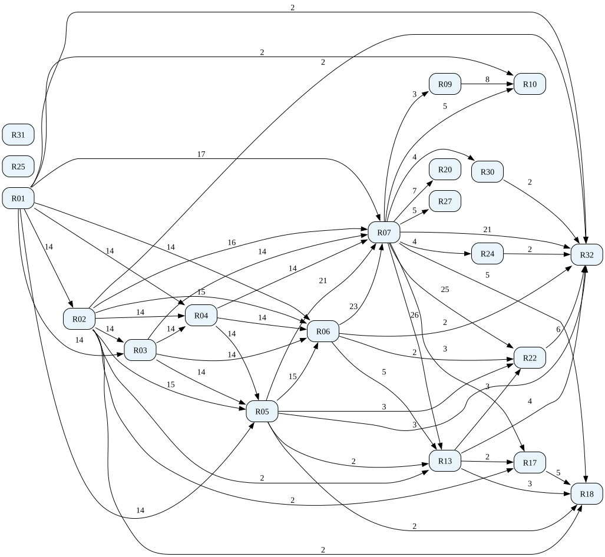

# Граф металлургических информационных ресурсов
# ЧернецовАА АСУ4-25-1м

# Лабораторная работа 1

В лабораторной сделал граф сайтов о металлургии. Сайты связываются между собой, если в их текстах есть одинаковые ключевые термины
Собрал 33 ссылки - исходные ссылки находятся в sources.csv. Для загрузки страниц использовал requests, а для получения текста BeautifulSoup. Брался текст из абзацев, заголовков и списков. После этого с помощью rutermextract были получены ключевые термины для каждой страницы
Дальше программа сравнивала термины у каждой пары сайтов. Если находилось хотя бы два одинаковых термина, между сайтами добавлялось ребро. Число на ребре означает количество общих терминов
В результате обработалось 29 страниц, между ними получилось 131 связь. Четыре страницы не подошли из-за ошибок загрузки или небольшого количества текста

Термины в terms.csv, а связи и общие термины в edges.csv

## Запуск

Установка зависимостей:
python -m pip install -r .\lab1\requirements.txt

Построение графов:
python .\lab1\graph.py

Из HTML удаляются скрипты, стили, меню, верхние и нижние блоки страниц
Термины извлекаются с помощью rutermextract
В результат попадают термины, которые встречаются на странице не менее двух раз
Ресурсы связываются, если у них есть не менее двух общих терминов. Вес ребра равен количеству общих терминов

Результаты
- Ресурсов в списке: 33;
- Успешно обработано: 20;
- Ошибок: 13;
- Узлов в графе: 20;
- Рёбер в общем графе: 54;
- Рёбер в межсайтовом графе: 31

Один ресурс вернул ошибку HTTP 500, на остальных необработанных страницах после очистки оказалось мало текста или терминов

terms.csv - термины по каждому обработанному ресурсу
errors.csv - ресурсы, которые не удалось обработать
edges.csv - все найденные связи и общие термины
graph.dot, graph.pdf, graph.svg - граф
edges_between_sites.csv -связи только между разными доменами
graph_between_sites.dot, graph_between_sites.pdf, graph_between_sites.svg - межсайтовый граф