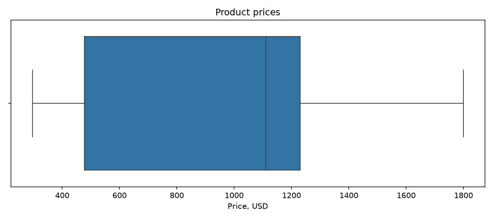

# Лабораторная работа 4. Предварительная обработка и первичный анализ веб-данных
Чернецов А. А., АСУ4-25-1м
Создан Scrapy-проект с двумя пауками:
- NewsSpider собирает новости с сайта ПНИПУ;
- EcommerceSpider собирает товары с динамического сайта Web Scraper через Playwright

## Запуск
Установка зависимостей:
python -m pip install -r .\lab3\requirements.txt
python -m playwright install chromium

Сбор новостей:
python .\lab3\run_spider.py --spider news --output news.json

Сбор товаров:
python .\lab3\run_spider.py --spider ecommerce --category laptops --output products.csv

Для новостей можно указать ключевые слова:
python .\lab3\run_spider.py --spider news --keywords "ПНИПУ,металлургия" --output news_filtered.json

Первичный анализ:
python .\lab3\analyze.py

В проекте используются:
- очистка текста от HTML через BeautifulSoup;
- нормализация пробелов и приведение служебных полей к нижнему регистру;
- заполнение необязательных текстовых пропусков;
- точная дедупликация по URL;
- нечёткая дедупликация по заголовку и описанию через RapidFuzz;
- повторные запросы при HTTP 429, 500, 502, 503 и 504;
- экспорт в JSON и CSV;
- заполнение цены медианой, а категории модой;
- поиск выбросов через Z-score и IQR;
- визуализация цен с помощью boxplot

Результаты:
- Собрано 111 товаров;
- Собрано 107 новостей;
- Удалено 6 повторов товаров;
- Удалено 10 повторов новостей;
- Медианная цена товара: 1110.14 USD;
- Выбросов по Z-score: 0;
- Выбросов по IQR: 0;
- После очистки осталось 111 товаров и 107 новостей

- news.json — собранные новости
- products.csv — собранные товары
- news_clean.csv — новости после первичной обработки
- products_clean.csv — товары после обработки и фильтрации выбросов
- analysis.txt — результаты анализа
- price_boxplot.png — распределение цен
- run_spider.py — запуск пауков
- analyze.py — первичный анализ данных

NewsSpider
Новости приходят в готовом HTML, поэтому используется обычный Scrapy без браузера. Пагинация выполняется через параметр PAGEN_1
Со сраницы списка паук получает заголовок, дату, теги и ссылку, затем открывает страницу новости и извлекает первый абзац как краткое описание
Если заданы ключевые слова, запись сохраняется при наличии хотя бы одного слова в заголовке или описании
Карточки без заголовка или ссылки пропускаются с предупреждением в логе

EcommerceSpider
Без JavaScript карточки товаров отсутствуют в отображаемом HTML, поэтому запрос выполняется через Chromium и scrapy-playwright
Функция collect_products() запускается как PageMetho, она последовательно переключает 20 AJAX-страниц, дожидается обновления активной страницы и собирает карточки товаров. Для каждого товара сохраняются название, описание, цена, рейтинг, количество отзывов и ссылка
Браузер используется только для этого паука, новости через Chromium не загружаются

pipelines.py
Записи обрабатываются в следующем порядке:
- CleaningPipeline удаляет HTML, исправляет кодировку, нормализует пробелы и преобразует числовые поля;
- ValidationPipeline отбрасывает записи без заголовка или URL. Необязательные текстовые пропуски заполняются пустыми строками;
- DuplicationPipeline удаляет точные повторы по URL;
- FuzzyDuplicationPipeline сравнивает записи через RapidFuzz. Повтором считается совпадение не только заголовка, но и описания, поэтому разные конфигурации одного товара сохраняются

Нижний регистр применяется к служебным полям normalized_title и normalized_description. Исходные заголовки и описания не изменяются

settings.py
Содержит общие настройки сбора:
- до двух одновременных запросов к одному домену;
- пауза между запросами с небольшим случайным отклонением;
- таймаут 30 секунд;
- три повторные попытки при HTTP 429, 500, 502, 503 и 504;
- подключение Playwright и Chromium;
- порядок запуска pipelines;
- экспорт текста в UTF-8

analyze.py
Выполняет первичный анализ без повторного обращения к сайтам:
- считает пропуски;
- удаляет точные дубликаты по URL;
- проверяет обязательные поля;
- заполняет цену медианой;
- заполняет категорию модой;
- вычисляет Z-score;
- вычисляет квартили, IQR и границы выбросов;
- сохраняет очищенные CSV;
- строит boxplot распределения цен

# Проверка работы

Оба паука были запущены через общий CLI.

 Собрано товаров - 111 
 Собрано новостей - 107 
 Удалено повторов товаров - 6 
 Удалено повторов новостей - 10 
 Записей без обязательных полей в результате - 0 
 Медианная цена - 1110.14 USD 
 Выбросов по Z-score - 0 
 Выбросов по IQR - 0 

Получилось больше 100 записей, потому что паук останавливается после превышения заданного порога, а уже обрабатываемая группа записей также попадает в экспорт